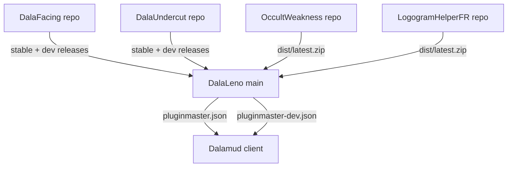

# Architecture

## Vue d'ensemble

Le workflow de DalaLeno télécharge et valide les packages produits ailleurs, puis les commite dans `plugins/<nom>/`. Les manifests pointent vers les fichiers bruts de `DalaLeno/main` ou, pour le DEV de Logogram Helper, vers sa branche source spécifique.

## DalaLeno : catalogue et synchronisation

- `pluginmaster.json` : catalogue stable de quatre plugins.
- `pluginmaster-dev.json` : flux de test pour Logogram Helper FR+, DalaUndercut et DalaFacing.
- `plugins/<plugin>/latest.zip` : copie stable consommée par Dalamud.
- `plugins/DalaFacing/dev-latest.zip` et `plugins/DalaUndercut/dev-latest.zip` : copies de développement.
- `.github/workflows/build-packages.yml` : synchronisation, tests ZIP, validation de l'icône DalaFacing et génération de l'icône DalaUndercut.

Le job checkout explicitement `main` et repousse ses changements sur `main`. Il ne constitue pas un système de promotion du code source.

## DalaFacing

### Structure

- `Plugin.cs` : services Dalamud, commandes, sélection de l'acteur, calcul/projection/rendu de la flèche et fenêtre de configuration.
- `Configuration.cs` : dimensions en yalms, couleurs et contour.
- `DalaFacing.csproj` : identité, version, cible .NET et métadonnées Dalamud.

### Dépendances et rendu

- `ITargetManager` et `IObjectTable` pour sélectionner et retrouver l'acteur par ID.
- `IGameGui.WorldToScreen` pour projeter les sommets 3D.
- matrice `Control.Instance()->ViewProjectionMatrix` pour calculer la profondeur caméra.
- ImGui foreground draw list pour dessiner les triangles et contours.

La flèche est un prisme fermé de 14 sommets. Les faces sont triangulées, triées du fond vers l'avant et ombrées. Les contours ne dessinent que les arêtes pertinentes des faces visibles. La position verticale est mesurée depuis l'origine au sol de l'acteur; la direction provient de `actor.Rotation`.

## DalaUndercut

### Structure

- `Plugin.Core.cs` : cycle de vie, services, écoute du Market Board, calcul du prix et contexte servant.
- `Plugin.Automation.cs` : machine à états et callbacks des addons UI.
- `Plugin.UI.cs` : bouton attaché et fenêtre de diagnostic/configuration.
- `Configuration.cs` : undercut, minimum, délai et options.
- `MarketSnapshot.cs` : dernier instantané de comparaison.

### Dépendances et flux

- `IMarketBoard.OfferingsReceived` reçoit les offres live du client.
- `IAddonLifecycle` observe `RetainerSell` et `ItemSearchResult`.
- `IGameGui` et `FFXIVClientStructs` accèdent aux addons et déclenchent leurs callbacks.
- `IFramework.Update` fait progresser la machine à états sans boucle bloquante.
- Lumina `Item` fournit le nom et la capacité HQ.

Flux simplifié : emplacement → menu contextuel → ajustement du prix → comparaison → offres live → filtrage HQ/NQ et servants personnels → calcul → fermeture du Market Board → saisie/confirmation → emplacement suivant.

## OccultWeakness

### Structure

- `Plugin.cs` : services, commande, recherche d'entrée par nom et overlay.
- `ConfigWindow.cs` : configuration, gestion des monstres et mode placement.
- `Configuration.cs`, `MobWeaknessEntry.cs`, `Element.cs` : modèle persistant.

### Dépendances et rendu

- `ITargetManager` donne la cible active.
- `ITextureProvider.GetFromGameIcon` charge les icônes élémentaires.
- ImGui dessine une fenêtre HUD sans entrée, sauf en mode placement.
- L'association par nom évite de dépendre d'IDs de monstres considérés instables dans ce contexte.

## Logogram Helper FR+

### Structure

- `Plugin.cs` : données JSON, localisation FR/EN, stock, commandes, fenêtres et modification des tooltips.
- `Windows/MainWindow.cs` : filtre, stock, langue et grille d'actions.
- `Windows/LogosWindow.cs` : détails, recettes, quantités possibles et sources.
- `Classes/*` : modèles des actions, recettes et logogrammes.
- `res/data/*.json` : données fonctionnelles copiées dans le package.

Le plugin dérive du projet original d'apetih; `THIRD_PARTY_NOTICE.md` et le crédit doivent être préservés.

## Compilation

- SDK observé : .NET 10.
- SDK Dalamud observé : `Dalamud.NET.Sdk/15.0.0`.
- Packageur observé : `DalamudPackager 15.0.0`.
- Les workflows installent la distribution de développement Dalamud dans le dossier XIVLauncher attendu, exécutent `dotnet restore`, puis `dotnet build` en Release.
- Le packageur produit un `latest.zip`; les workflows le renomment ou le copient selon le canal.

## Déploiement

### DalaFacing et DalaUndercut

1. Push sur `dev` → CI + mise à jour de la prerelease `dev-latest`.
2. Test en jeu.
3. Workflow manuel de promotion → PR `dev` vers `main`.
4. Fusion manuelle après validation → build et GitHub Release stable versionnée.
5. Synchronisation du package par DalaLeno.

### OccultWeakness et Logogram Helper FR+

Les workflows stables construisent et committent `dist/latest.zip` sur `main`, avec `[skip ci]` pour éviter les boucles. Logogram Helper possède en plus un canal `dev-language-toggle` qui produit `dist/dev-latest.zip`.

### DalaLeno

Une modification de manifest ou un déclenchement manuel lance la synchronisation. Le job valide les archives avant de committer les copies dans `main`.
